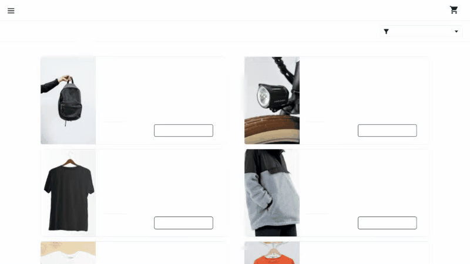
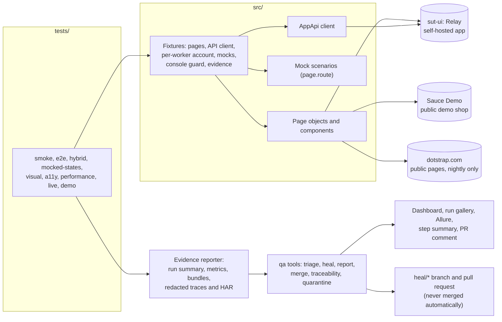

# playwright-typescript-ui-Dotstrap-Automation

Production-style UI test framework: TypeScript, Playwright, axe, Allure, GitHub Actions, with
end-to-end, hybrid, mocked-state, visual, accessibility and performance tests, a polite live smoke,
failure triage and governed self-healing.

[](https://github.com/kesireddy-kishore-29/playwright-typescript-ui-Dotstrap-Automation/actions/workflows/ci.yml)
[](https://github.com/kesireddy-kishore-29/playwright-typescript-ui-Dotstrap-Automation/actions/workflows/nightly.yml)
[](https://github.com/kesireddy-kishore-29/playwright-typescript-ui-Dotstrap-Automation/actions/workflows/nightly.yml)
[](https://kesireddy-kishore-29.github.io/playwright-typescript-ui-Dotstrap-Automation/)
[](LICENSE)
[](package.json)
[](package.json)
[](package.json)

## See it in 60 seconds

- **Live report:** [dashboard](https://kesireddy-kishore-29.github.io/playwright-typescript-ui-Dotstrap-Automation/)
  and [Allure with trend](https://kesireddy-kishore-29.github.io/playwright-typescript-ui-Dotstrap-Automation/allure/),
  published by the nightly run. _CI status: first run pending; the images below are from real
  local runs._
- **If you only have 60 seconds**, open:
  1. [`tests/hybrid/inbox.spec.ts`](tests/hybrid/inbox.spec.ts): seeded through the API, checked in
     the UI, cleaned up and proven gone.
  2. [The self-healing demo](docs/examples/self-healing-demo/): a renamed test id, one verified fix
     on a branch, nothing merged.
  3. [The locator policy](docs/locator-policy.md): role and accessible name first, and why.




## At a glance

|                 |                                                                                                                                                                                                                                |
| --------------- | ------------------------------------------------------------------------------------------------------------------------------------------------------------------------------------------------------------------------------ |
| Tests           | **64** runs in `npm test` (chromium, mobile, visual, a11y), **28** in the live smoke, 4 deliberate failures in the demo; 90 distinct tests in 96 runs, because 6 run on desktop and mobile; 103 tooling unit tests             |
| Features traced | **37 of 37** feature IDs in [`features.json`](features.json) have a test; a test without one fails CI                                                                                                                          |
| Runs verified   | 3 runs of `npm test` (`ui-allure-10` to `12`), 64/64 each, on 2026-10-22 at commit `ec03fd6`; live smoke 28/28 at `93cee4a` the same day (Windows 11, Node 24)                                                                 |
| Flaky tests     | 0 over those 3 runs                                                                                                                                                                                                            |
| Stack           | TypeScript 6 (strict), Playwright 1.64, axe-core, Allure, zod, ESLint, Prettier, commitlint, GitHub Actions                                                                                                                    |
| What is unusual | Hybrid tests with proven cleanup; network states on demand; visual at 4 widths × 2 themes; accessibility against a reviewed baseline; triage from the DOM at failure; healing that proposes a verified branch and never merges |
| CI status       | Workflows pass actionlint and shellcheck; the first run on GitHub is pending, and Linux visual baselines come from their own workflow ([known issues](docs/known-issues.md))                                                   |

## What's covered

| Suite         | What it verifies                                                                                                           | Runs          | Projects            | Feature IDs | Folder                                 |
| ------------- | -------------------------------------------------------------------------------------------------------------------------- | ------------- | ------------------- | ----------- | -------------------------------------- |
| smoke         | A saved session opens the app signed in; the sign-in page offers its fields                                                | 4 (2 tests)   | chromium, mobile    | 2           | [smoke/](tests/smoke/)                 |
| e2e           | Sauce Demo sign-in, inventory, cart, checkout and sign-out                                                                 | 23 (20 tests) | chromium, mobile    | 12          | [e2e/](tests/e2e/)                     |
| hybrid        | Inbox and items seeded through the API, checked in the UI, cleaned up and proven gone                                      | 5 (4 tests)   | chromium, mobile    | 3           | [hybrid/](tests/hybrid/)               |
| mocked-states | Expired session, server error with retry, empty, slow, a failing widget, rate limited                                      | 6             | chromium            | 6           | [mocked-states/](tests/mocked-states/) |
| visual        | Inbox and items at 1440, 1024, 768 and 390 px in light and dark, no overflow, theme kept                                   | 17            | visual              | 3           | [visual/](tests/visual/)               |
| a11y          | axe (WCAG 2.1 A/AA) on the app pages and a dialog; a deliberately broken page against its baseline                         | 5             | a11y                | 2           | [a11y/](tests/a11y/)                   |
| performance   | Navigation-timing budgets for `/login`, `/inbox`, `/items`                                                                 | 3             | chromium            | 1           | [performance/](tests/performance/)     |
| live          | dotstrap.com public pages: status, heading, console, security headers, meta, overflow, themes, navigation, a timing budget | 28            | live (nightly only) | 8           | [live/](tests/live/)                   |
| demo          | Fails on purpose, one test per failure path                                                                                | 4             | demo                | 1           | [demo/](tests/demo/)                   |
| setup         | Signs in to Sauce Demo once and saves the session                                                                          | 1             | setup               | 1           | [setup/](tests/setup/)                 |

`npm run test:smoke` selects the 5 tests tagged `@smoke` (the 2 above and 3 in e2e) plus the setup
project: 6 runs. Targets: [Sauce Demo](https://www.saucedemo.com) (public demo shop), `sut-ui`
(a self-hosted app in this repository) and dotstrap.com (public pages only)
([ADR 2](docs/adr/0002-three-targets.md)).

## Run it

Prerequisites: Node 22.12 or later.

```bash
npm ci                              # 1. install
npx playwright install chromium     # 2. the browser
npm run test:smoke                  # 3. smoke (6 runs)
npm test                            # 4. the full gate: chromium, mobile, visual, a11y (starts sut-ui itself)
npx playwright show-report          # 5. open the HTML report
```

The same five commands work in Windows PowerShell. Run modes:

| Run mode                              | Command                                                                                                                  | Output                                                                                      |
| ------------------------------------- | ------------------------------------------------------------------------------------------------------------------------ | ------------------------------------------------------------------------------------------- |
| Smoke                                 | `npm run test:smoke`                                                                                                     | `run-evidence/playwright-typescript-ui-Dotstrap-Automation/<run-id>/`, `playwright-report/` |
| Full gate                             | `npm test`                                                                                                               | same                                                                                        |
| Live smoke (public pages, one worker) | `npm run test:live`                                                                                                      | same; never committed or published                                                          |
| Evidence for every test               | `RECORD_MODE=all npm test` (`failures` is the default, `off` keeps none); PowerShell: `$env:RECORD_MODE='all'; npm test` | `run-evidence/.../<run-id>/`                                                                |
| Deliberate-failure demo               | `npm run test:demo` (4 tests fail on purpose)                                                                            | failure bundles in `run-evidence/.../<run-id>/failure-bundles/`                             |
| Chaos for the healing demos           | `SUT_UI_CHAOS=rename-testid` or `restyle-table` before `npm test`                                                        | as above                                                                                    |

`RUN_ID=<id>` names the run folder; `TEST_RETRIES=0..2` sets retries.

## Reports and evidence

| Report                 | What it shows                                                                                                      | Published                           | Open locally                                                                                                                                       |
| ---------------------- | ------------------------------------------------------------------------------------------------------------------ | ----------------------------------- | -------------------------------------------------------------------------------------------------------------------------------------------------- |
| Health dashboard       | Pass rate and trend, triage categories, healing ledger, accessibility by impact, performance budgets, visual diffs | Pages root                          | `npm run qa -- report --run run-evidence/playwright-typescript-ui-Dotstrap-Automation/<run-id> --out reports/site`, then `reports/site/index.html` |
| Allure                 | Every test with steps and attachments, history trend, categories                                                   | Pages `/allure/`                    | `scripts/allure-report.sh`, then `npx allure open allure-report` (Allure needs Java)                                                               |
| Playwright HTML report | Per-test steps, errors, traces                                                                                     | –                                   | `npx playwright show-report`                                                                                                                       |
| Trace                  | DOM snapshots, network, console and source per step (redacted)                                                     | inside each failure bundle          | `npx playwright show-trace <bundle>/attempt-1/trace.zip` or https://trace.playwright.dev                                                           |
| Run gallery            | Each failed test, attempt by attempt, with video and evidence                                                      | Pages `/runs/<run-id>/gallery.html` | `run-evidence/.../<run-id>/gallery.html` (after `qa report`)                                                                                       |

A failed attempt keeps a **video**, a **redacted trace**, screenshots (viewport and full page), the
console log, a redacted HAR, the page source and metadata, gathered into a **failure bundle**;
triage adds a category and a one-page report. Cookies, credential headers and secret fields are
masked everywhere, and paths are made relative. Example:
[docs/examples/failure-evidence](docs/examples/failure-evidence/).


Accessibility and performance appear on the dashboard as tables (violations by impact, budget per
page); see [docs/reporting.md](docs/reporting.md) and the
[light](docs/examples/dashboard/dashboard-light.png) and
[390 px](docs/examples/dashboard/dashboard-390px.png) views.

## Standards demonstrated

| Practice                                                                   | Where it is                                                                                                        |
| -------------------------------------------------------------------------- | ------------------------------------------------------------------------------------------------------------------ |
| Page objects and components with a written locator policy                  | [`src/pages/`](src/pages/), [`src/components/`](src/components/), [docs/locator-policy.md](docs/locator-policy.md) |
| Fixtures instead of setup code in tests                                    | [`src/fixtures/`](src/fixtures/)                                                                                   |
| Sign in once and reuse the session                                         | `setup` project and the per-worker account in [`app.ts`](src/fixtures/app.ts)                                      |
| Hybrid tests: seed through the API, check the UI, verified cleanup         | [`tests/hybrid/`](tests/hybrid/), [`AppApi`](src/clients/AppApi.ts)                                                |
| Network states a real backend rarely gives on demand                       | [`src/mocks/`](src/mocks/), [`tests/mocked-states/`](tests/mocked-states/)                                         |
| Visual regression at 4 widths × 2 themes, overflow checks                  | [`tests/visual/`](tests/visual/)                                                                                   |
| Accessibility (axe, WCAG 2.1 A/AA) with a documented-defects baseline      | [`tests/a11y/`](tests/a11y/)                                                                                       |
| Performance budgets (Navigation Timing)                                    | [`tests/performance/`](tests/performance/)                                                                         |
| A live production smoke that never gates and never signs in                | [`tests/live/`](tests/live/), [`live-pages.ts`](src/config/live-pages.ts)                                          |
| Configuration validated with zod at start-up                               | [`env.ts`](src/config/env.ts)                                                                                      |
| Console-error guard and redacted evidence on every test                    | [`base.ts`](src/fixtures/base.ts), [`redact.ts`](src/support/redact.ts)                                            |
| Triage into seven categories from the DOM at failure, rules first          | [`tools/src/triage/`](tools/src/triage/)                                                                           |
| Self-healing with guardrails in code, never auto-merged                    | [docs/self-healing.md](docs/self-healing.md)                                                                       |
| Flaky tests and quarantine with owners and expiry dates                    | [`quarantine.json`](quarantine.json), [test strategy](docs/test-strategy.md#flaky-tests-and-quarantine)            |
| Requirements traceability, enforced                                        | [`features.json`](features.json), `npm run qa -- traceability`                                                     |
| CI: pull-request gate, sharded nightly, Pages, heal and baseline workflows | [`.github/workflows/`](.github/workflows/)                                                                         |
| Quality gates                                                              | TypeScript strict, ESLint with the Playwright plugin, Prettier, commitlint, a 2 MB file guard                      |

## Architecture



Tests ask fixtures for pages, an API client and mocks; page objects and components are the only
code that finds elements. A reporter writes the run's evidence, redacted, and the `qa` tools read
it to triage, heal and build the reports.

## Self-healing and triage

Triage puts every failure in one of seven categories (`LOCATOR_DRIFT`, `TIMING`, `TEST_DATA`,
`CONTRACT_DRIFT`, `ENVIRONMENT`, `PRODUCT_BUG`, `UNKNOWN`), reading the DOM at the moment of
failure, rules first. The demonstrated healer is **rule-based with guardrails**: it proposes a fix
on a `heal/*` branch with a pull-request body, verifies it (lint, type-check, the failing test three
times, its file), and **never merges**; only test-id drift is healed
([ADR 4](docs/adr/0004-locators-role-first.md)). An optional AI step is implemented and unit-tested
with a fake transport but has **not been run against a live model**.

In the [demo](docs/examples/self-healing-demo/), the app renamed the unread badge's test id. The
gate failed 1 of 47 runs, triaged `LOCATOR_DRIFT`; the healer renamed the id in the component and
page object that use it, and the gate passed 47/47 on the heal branch, which is pushed as a demo
branch and never merged:
[`heal/locator-drift/…-20261022`](https://github.com/kesireddy-kishore-29/playwright-typescript-ui-Dotstrap-Automation/tree/heal/locator-drift/chromium-inbox-seeded-through-the-api-the-bell-counts-unread-messages-and-readin-20261022).
How it works: [docs/self-healing.md](docs/self-healing.md).

## Design decisions

- Three targets, each for what only it can give; the live site never gates
  ([ADR 2](docs/adr/0002-three-targets.md), [ADR 3](docs/adr/0003-live-smoke-policy.md)).
- Sign in once and reuse the session ([ADR 11](docs/adr/0011-saved-session-over-ui-login.md)).
- Role and accessible name first; only test-id drift is healed ([ADR 4](docs/adr/0004-locators-role-first.md)).
- Visual baselines per operating system, generated where they are compared ([ADR 5](docs/adr/0005-visual-baselines-per-os.md)).
- Evidence collected by a reporter, everything redacted, traces included ([ADR 6](docs/adr/0006-evidence-reporter-and-redaction.md)).
- Healing proposes pull requests; people merge ([ADR 8](docs/adr/0008-governed-self-healing.md)).
- Playwright and TypeScript from a job-market analysis, one repository per stack ([ADR 10](docs/adr/0010-why-playwright-typescript.md)).

All eleven decisions: [docs/adr/](docs/adr/). Every document: [docs/](docs/README.md).

## Real-world origin and family of repos

The scenarios (a saved signed-in session, an unread badge that must actually be painted in both
themes, empty, slow, failing and rate-limited states, responsive and theme acceptance at four
widths, reading the rendered page instead of trusting a 200) come from the author's own production
project, [dotstrap](https://dotstrap.com). They are rebuilt from scratch against the self-hosted
app and a public demo shop; no dotstrap code, configuration or data is used. The only contact with
dotstrap itself is the live smoke: public pages only, no sign-in, no forms, one worker, a user
agent that names this project, never gating a merge.

| Repository                                                                                                                           | Role                                                                                                                                 |
| ------------------------------------------------------------------------------------------------------------------------------------ | ------------------------------------------------------------------------------------------------------------------------------------ |
| [restassured-testng-api-Dotstrap-Automation](https://github.com/kesireddy-kishore-29/restassured-testng-api-Dotstrap-Automation)     | API flagship in Java, with the same triage, healing and dashboard (the template is shared byte for byte)                             |
| **playwright-typescript-ui-Dotstrap-Automation** (this one)                                                                          | UI flagship                                                                                                                          |
| [selenium-java-testng-ui-Dotstrap-Automation](https://github.com/kesireddy-kishore-29/selenium-java-testng-ui-Dotstrap-Automation)   | The same Sauce Demo scenarios in Selenium 4 and Java, same feature IDs; its table and dialog tests reuse this repository's app in CI |
| [Python-pytest-playwright-Dotstrap-Automation](https://github.com/kesireddy-kishore-29/Python-pytest-playwright-Dotstrap-Automation) | API and UI tests in Python with Playwright for Python; its hybrid test reuses this repository's app                                  |

## Known limitations

- The workflows have not run on GitHub yet; Pages, the PR comment and `heal --open-prs` are untested.
- Visual baselines exist for Windows only until `visual-baselines.yml` runs; CI skips `visual` until then.
- Chromium and a Pixel 7 profile only; Firefox and WebKit are not in any project.
- The AI step of triage and healing has never called a live model.
- The live smoke follows a site that changes on its own schedule; it never gates a merge.
- Sauce Demo has quirks recorded as findings (deep-link 404, a telemetry 401).

Details: [docs/known-issues.md](docs/known-issues.md).

## Author

[kesireddy-kishore-29](https://github.com/kesireddy-kishore-29) on GitHub.
