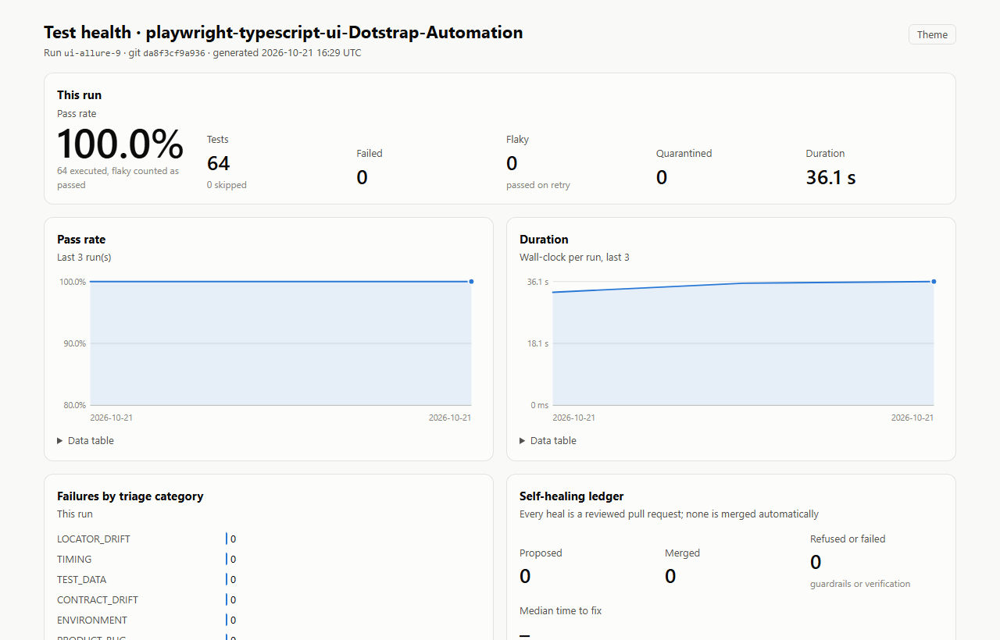
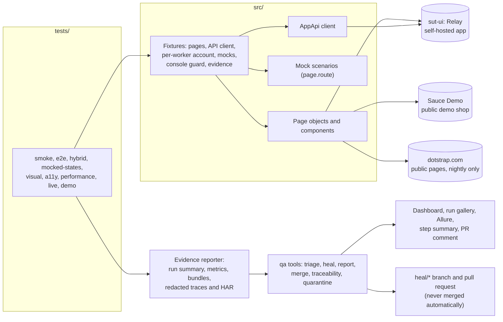

# playwright-typescript-ui-Dotstrap-Automation

UI test automation in TypeScript with Playwright: end-to-end, hybrid, mocked-state, visual,
accessibility and performance tests, a polite live smoke of a production site, failure triage and
governed self-healing.

[](https://github.com/kesireddy-kishore-29/playwright-typescript-ui-Dotstrap-Automation/actions/workflows/ci.yml)
[](https://github.com/kesireddy-kishore-29/playwright-typescript-ui-Dotstrap-Automation/actions/workflows/nightly.yml)
[](https://github.com/kesireddy-kishore-29/playwright-typescript-ui-Dotstrap-Automation/actions/workflows/nightly.yml)
[](https://kesireddy-kishore-29.github.io/playwright-typescript-ui-Dotstrap-Automation/)



|                 |                                                                                                                                                                                                                                                          |
| --------------- | -------------------------------------------------------------------------------------------------------------------------------------------------------------------------------------------------------------------------------------------------------- |
| Tests           | 64 in `npm test` (chromium, mobile, visual, a11y), 28 in the live smoke, 4 deliberate failures in the demo project; all passed in the latest local runs                                                                                                  |
| Run time        | About 45 s for `npm test` on a laptop, 4 workers                                                                                                                                                                                                         |
| Features traced | 37 of 37 feature IDs have at least one test; a test without one fails                                                                                                                                                                                    |
| Status          | Verified locally on Windows 11. The workflows pass actionlint and shellcheck but **have not run on GitHub yet**, and the visual baselines exist for Windows only; the badges turn green only after the first push ([known issues](docs/known-issues.md)) |

## Standards demonstrated

| Practice                                                                           | Where it is                                                                                                        |
| ---------------------------------------------------------------------------------- | ------------------------------------------------------------------------------------------------------------------ |
| Page objects and components with a written locator policy                          | [`src/pages/`](src/pages/), [`src/components/`](src/components/), [docs/locator-policy.md](docs/locator-policy.md) |
| Fixtures instead of setup code in tests                                            | [`src/fixtures/`](src/fixtures/)                                                                                   |
| Sign in once and reuse the session                                                 | `setup` project and the per-worker account in [`app.ts`](src/fixtures/app.ts)                                      |
| Hybrid tests: seed through the API, check the UI, verified cleanup                 | [`tests/hybrid/`](tests/hybrid/), [`AppApi`](src/clients/AppApi.ts)                                                |
| Network states a real backend rarely gives on demand                               | [`src/mocks/`](src/mocks/), [`tests/mocked-states/`](tests/mocked-states/)                                         |
| Visual regression at 4 widths × 2 themes, overflow checks                          | [`tests/visual/`](tests/visual/)                                                                                   |
| Accessibility (axe, WCAG 2.1 A/AA) with a documented-defects baseline              | [`tests/a11y/`](tests/a11y/)                                                                                       |
| Performance budgets (Navigation Timing)                                            | [`tests/performance/`](tests/performance/)                                                                         |
| A live production smoke that never gates and never signs in                        | [`tests/live/`](tests/live/), [`live-pages.ts`](src/config/live-pages.ts)                                          |
| Configuration validated with zod at start-up                                       | [`env.ts`](src/config/env.ts)                                                                                      |
| Console-error guard and redacted evidence on every test                            | [`base.ts`](src/fixtures/base.ts), [`redact.ts`](src/support/redact.ts)                                            |
| Failure evidence: video, redacted trace, screenshots, HAR, console, DOM            | [docs/reporting.md](docs/reporting.md)                                                                             |
| Triage into seven categories from the DOM at failure, rules first                  | [`tools/src/triage/`](tools/src/triage/)                                                                           |
| Self-healing with guardrails in code, never auto-merged                            | [docs/self-healing.md](docs/self-healing.md)                                                                       |
| Health dashboard with accessibility, budgets and visual diffs; Allure with history | [docs/reporting.md](docs/reporting.md)                                                                             |
| Flaky tests and quarantine with owners and expiry dates                            | [`quarantine.json`](quarantine.json), [test strategy](docs/test-strategy.md#flaky-tests-and-quarantine)            |
| Requirements traceability, enforced                                                | [`features.json`](features.json), `npm run qa -- traceability`                                                     |
| CI: pull-request gate, sharded nightly, Pages, heal and baseline workflows         | [`.github/workflows/`](.github/workflows/)                                                                         |
| Quality gates                                                                      | TypeScript strict, ESLint with the Playwright plugin, Prettier, commitlint, a 2 MB file guard                      |

## Architecture



## What is tested

| Project    | Tests | What it covers                                                                                                                                   | Target                     |
| ---------- | ----- | ------------------------------------------------------------------------------------------------------------------------------------------------ | -------------------------- |
| `setup`    | 1     | Signs in to Sauce Demo once and saves the session                                                                                                | Sauce Demo                 |
| `chromium` | 35    | Smoke, e2e (login, inventory, cart, checkout, logout), hybrid, mocked network states, performance budgets                                        | Sauce Demo, sut-ui         |
| `mobile`   | 6     | The `@mobile` journeys on a Pixel 7 profile                                                                                                      | Sauce Demo, sut-ui         |
| `visual`   | 17    | Inbox and items at 1440, 1024, 768 and 390 px in light and dark, no horizontal overflow, theme persistence                                       | sut-ui                     |
| `a11y`     | 5     | axe on the app pages and a dialog; a deliberately broken page against its reviewed baseline                                                      | sut-ui                     |
| `live`     | 28    | Public pages answer and show the right heading, no console errors, security headers, meta, no overflow, both themes, navigation, a timing budget | dotstrap.com, nightly only |
| `demo`     | 4     | Fails on purpose, one test per failure path                                                                                                      | sut-ui                     |

## Traceability

Every test carries a `feature` annotation from [`features.json`](features.json); a test without one
fails. "Tests" counts the tests that cover an area, once each whatever the number of projects
they run in. The dashboard shows the full matrix ([example](docs/examples/dashboard/dashboard-light.png)).

| Area                                       | Features | Covered | Tests | Projects                |
| ------------------------------------------ | -------- | ------- | ----- | ----------------------- |
| Login and logout (`LOGIN`, `LOGOUT`)       | 4        | 4       | 8     | chromium, mobile        |
| Inventory (`INV`)                          | 3        | 3       | 6     | chromium                |
| Cart (`CART`)                              | 2        | 2       | 2     | chromium, mobile        |
| Checkout (`CHECKOUT`)                      | 3        | 3       | 5     | chromium, mobile        |
| Saved session (`SESSION`)                  | 1        | 1       | 2     | setup, chromium, mobile |
| Inbox and items, hybrid (`INBOX`, `ITEMS`) | 3        | 3       | 4     | chromium, mobile        |
| Network states (`STATE`)                   | 6        | 6       | 6     | chromium                |
| Visual and theme (`VIS`, `THEME`)          | 3        | 3       | 17    | visual                  |
| Accessibility (`A11Y`)                     | 2        | 2       | 5     | a11y                    |
| Performance (`PERF`)                       | 1        | 1       | 3     | chromium                |
| Live smoke (`LIVE`)                        | 8        | 8       | 28    | live                    |
| Deliberate-failure demo (`DEMO`)           | 1        | 1       | 4     | demo                    |
| **Total**                                  | **37**   | **37**  |       |                         |

## Design decisions

- Three targets, each for what only it can give; the live site never gates
  ([ADR 2](docs/adr/0002-three-targets.md), [ADR 3](docs/adr/0003-live-smoke-policy.md)).
- Sign in once and reuse the session ([ADR 11](docs/adr/0011-saved-session-over-ui-login.md)).
- Role and accessible name first; only test-id drift is healed ([ADR 4](docs/adr/0004-locators-role-first.md)).
- Visual baselines per operating system, generated where they are compared ([ADR 5](docs/adr/0005-visual-baselines-per-os.md)).
- Evidence collected by a reporter, everything redacted, traces included ([ADR 6](docs/adr/0006-evidence-reporter-and-redaction.md)).
- Healing proposes pull requests; people merge ([ADR 8](docs/adr/0008-governed-self-healing.md)).
- Playwright and TypeScript from a job-market analysis, one repository per stack ([ADR 10](docs/adr/0010-why-playwright-typescript.md)).

All eleven decisions: [docs/adr/](docs/adr/).

## Self-healing

A real run: the app renamed the notification badge's test id. The pull-request gate failed 1 of 47
tests; triage read the DOM at failure and classified it `LOCATOR_DRIFT`; the rule-based healer
renamed the id in the component and page object that use it; the guardrails passed; the verifier ran
lint, the type-check, the test 3 times and its file; and the gate passed 47/47 on the heal branch.
Nothing was merged. Every artifact is in [docs/examples/self-healing-demo](docs/examples/self-healing-demo/);
how it works is in [docs/self-healing.md](docs/self-healing.md).

## Failure evidence

`RECORD_MODE` decides how much each test keeps: `failures` (pull requests, the default), `all`
(nightly and local analysis), `off`. A failed attempt keeps a video, a redacted trace, screenshots,
the console log, a redacted HAR, the page source and metadata, gathered into a failure bundle. The
`demo` project fails on purpose, one test per failure path; a bundle from a real run of it, with
its video, is in [docs/examples/failure-evidence](docs/examples/failure-evidence/).

## Real-world origin

The scenarios here (a saved signed-in session, an unread badge that must actually be painted in
both themes, empty, slow, failing and rate-limited states, responsive and theme acceptance at four
widths, reading the rendered page instead of trusting a 200) come from the author's own production
project, [dotstrap](https://dotstrap.com). They are rebuilt from scratch against the self-hosted
app and a public demo shop; no dotstrap code, configuration or data is used.

The only contact with dotstrap itself is the live smoke: public pages only, no sign-in, no forms,
no data created, no calls to its backend, one worker, a user agent that names this project, never
gating a merge. Its evidence is never published or committed.

## Family of repos

- [**restassured-testng-api-Dotstrap-Automation**](https://github.com/kesireddy-kishore-29/restassured-testng-api-Dotstrap-Automation): the API flagship in Java with REST Assured and TestNG, with the same triage, healing and dashboard (the template is shared byte for byte).
- **playwright-typescript-ui-Dotstrap-Automation** (this one): the UI flagship.
- [**selenium-java-testng-ui-Dotstrap-Automation**](https://github.com/kesireddy-kishore-29/selenium-java-testng-ui-Dotstrap-Automation): the same Sauce Demo scenarios in Selenium 4 and Java, with the same feature IDs; its table and dialog tests reuse this repository's self-hosted app in CI.
- [**Python-pytest-playwright-Dotstrap-Automation**](https://github.com/kesireddy-kishore-29/Python-pytest-playwright-Dotstrap-Automation): API and UI tests in Python with Playwright for Python; its hybrid test reuses this repository's self-hosted app.

## How to run

You need Node 22.12 or later.

```bash
npm ci
npx playwright install chromium
npm test                    # chromium, mobile, visual and a11y (starts sut-ui itself)
npm run test:smoke          # the smoke-tagged tests
npm run test:live           # the live smoke: public pages of dotstrap.com, one worker
npm run test:demo           # four tests that fail on purpose

npm run qa -- triage --run run-evidence/playwright-typescript-ui-Dotstrap-Automation/<run-id>
npm run qa -- report --run run-evidence/playwright-typescript-ui-Dotstrap-Automation/<run-id> --out reports/site
scripts/allure-report.sh    # Allure with trend history (traces redacted first)
```

Switches: `RECORD_MODE=failures|all|off`, `RUN_ID=<id>`, `TEST_RETRIES=0..2`,
`SUT_UI_CHAOS=rename-testid|restyle-table`. More in the [test strategy](docs/test-strategy.md),
[locator policy](docs/locator-policy.md), [reporting](docs/reporting.md) and
[known issues](docs/known-issues.md).
