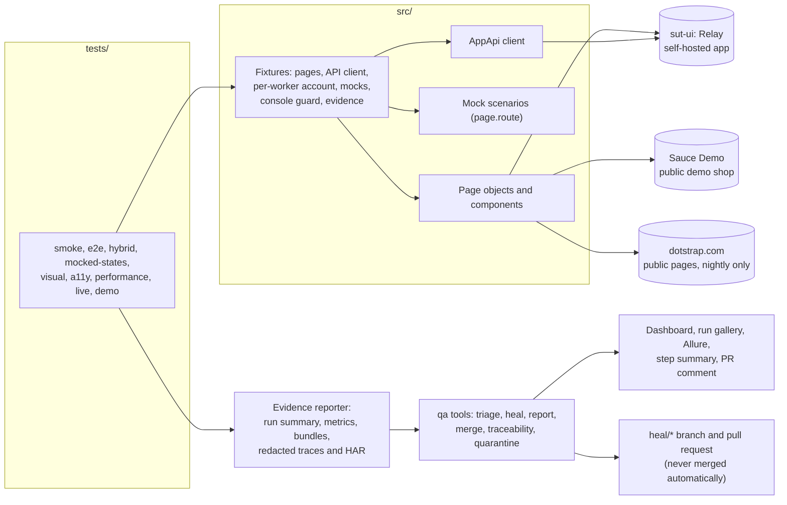

# ui-automation-framework

UI test automation in TypeScript with Playwright: end-to-end, hybrid (API and UI), mocked network
states, visual, accessibility and performance tests against a self-hosted app and a public demo
shop, plus a polite live smoke of a real production site. Every failure is triaged into one of seven
categories. For the healable ones, a guarded and verified fix is proposed on a branch for a person
to review.

|                 |                                                                                                                                                                                                                           |
| --------------- | ------------------------------------------------------------------------------------------------------------------------------------------------------------------------------------------------------------------------- |
| Tests           | 64 in `npm test` (chromium, mobile, visual, a11y), 28 in the live smoke, 4 deliberate failures in the demo project                                                                                                        |
| Run time        | About 45 s for `npm test` on a laptop, 4 workers                                                                                                                                                                          |
| Features traced | 37 of 37 feature IDs have at least one test                                                                                                                                                                               |
| Status          | Verified locally on Windows 11. The GitHub Actions workflows pass actionlint and shellcheck but have **not run on GitHub yet**; the visual baselines exist for Windows only so far ([known issues](docs/known-issues.md)) |

## What a reviewer usually looks for

| Practice                                                                           | Where it is                                                                                                        |
| ---------------------------------------------------------------------------------- | ------------------------------------------------------------------------------------------------------------------ |
| Page objects and components with a written locator policy                          | [`src/pages/`](src/pages/), [`src/components/`](src/components/), [docs/locator-policy.md](docs/locator-policy.md) |
| Fixtures instead of setup code in tests                                            | [`src/fixtures/`](src/fixtures/)                                                                                   |
| Sign in once, reuse the session                                                    | `setup` project and the per-worker account in [`app.ts`](src/fixtures/app.ts)                                      |
| Hybrid tests: seed through the API, check in the UI, clean up verifiably           | [`tests/hybrid/`](tests/hybrid/), [`AppApi`](src/clients/AppApi.ts)                                                |
| Network states a real backend rarely gives on demand                               | [`src/mocks/`](src/mocks/), [`tests/mocked-states/`](tests/mocked-states/)                                         |
| Visual regression at 4 widths × 2 themes                                           | [`tests/visual/`](tests/visual/)                                                                                   |
| Accessibility (axe, WCAG 2.1 A/AA) with a documented-defects baseline              | [`tests/a11y/`](tests/a11y/)                                                                                       |
| Performance budgets (Navigation Timing)                                            | [`tests/performance/`](tests/performance/)                                                                         |
| A live production smoke that never gates and never logs in                         | [`tests/live/`](tests/live/), [test strategy](docs/test-strategy.md#the-live-smoke)                                |
| Console-error guard and redacted evidence on every test                            | [`base.ts`](src/fixtures/base.ts), [`redact.ts`](src/support/redact.ts)                                            |
| Failure evidence: video, redacted trace, screenshots, HAR, console, DOM            | [docs/reporting.md](docs/reporting.md)                                                                             |
| Triage into seven categories, rules first                                          | [`tools/src/triage/`](tools/src/triage/)                                                                           |
| Self-healing with guardrails in code, never auto-merged                            | [docs/self-healing.md](docs/self-healing.md), [a real demo](docs/examples/self-healing-demo/)                      |
| Health dashboard with accessibility, budgets and visual diffs; Allure with history | [docs/reporting.md](docs/reporting.md)                                                                             |
| Flaky tests and quarantine with owners and expiry dates                            | [`quarantine.json`](quarantine.json), [test strategy](docs/test-strategy.md#flaky-tests-and-quarantine)            |
| Requirements traceability, enforced                                                | [`features.json`](features.json); `npm run qa -- traceability` fails on a test without a feature ID                |
| CI: pull-request gate, sharded nightly, Pages, heal and baseline workflows         | [`.github/workflows/`](.github/workflows/)                                                                         |
| Quality gates                                                                      | TypeScript strict, ESLint (with the Playwright plugin), Prettier, commitlint, a 2 MB file guard                    |
| Decisions written down                                                             | [docs/adr/](docs/adr/)                                                                                             |

## How it fits together



## Quick start

You need Node 22.12 or later.

```bash
npm ci
npx playwright install chromium
npm test                    # chromium, mobile, visual and a11y projects (starts sut-ui itself)
npm run test:smoke          # the smoke-tagged tests
npm run test:live           # the live smoke: public pages of dotstrap.com, one worker
npm run test:demo           # four tests that fail on purpose, to see the evidence and triage
```

| Switch                                         | Effect                                                                                   |
| ---------------------------------------------- | ---------------------------------------------------------------------------------------- |
| `RECORD_MODE=failures` (default), `all`, `off` | How much evidence each test keeps                                                        |
| `RUN_ID=<id>`                                  | Names the run folder under `run-evidence/ui-automation-framework/`                       |
| `TEST_RETRIES=0..2`                            | Retries (2 on CI by default, 0 locally); a test that passes on a retry is reported flaky |
| `SUT_UI_CHAOS=rename-testid`, `restyle-table`  | Breaks a test id, or ships an unintended style change, in the self-hosted app            |

After a run:

```bash
npm run qa -- triage --run run-evidence/ui-automation-framework/<run-id>
npm run qa -- report --run run-evidence/ui-automation-framework/<run-id> --out reports/site
scripts/allure-report.sh                      # Allure with trend history (traces redacted first)
npm run qa -- heal --run run-evidence/ui-automation-framework/<run-id>
npm run qa -- traceability                    # fails on a test without a feature ID
```

## Projects

| Project    | Tests | What it covers                                                                                                                  | Target                     |
| ---------- | ----- | ------------------------------------------------------------------------------------------------------------------------------- | -------------------------- |
| `setup`    | 1     | Signs in to Sauce Demo once and saves the session                                                                               | Sauce Demo                 |
| `chromium` | 35    | Smoke, e2e (login, inventory, cart, checkout, logout), hybrid, mocked network states, performance budgets                       | Sauce Demo, sut-ui         |
| `mobile`   | 6     | The `@mobile`-tagged journeys on a Pixel 7 profile                                                                              | Sauce Demo, sut-ui         |
| `visual`   | 17    | Inbox and items at 1440, 1024, 768 and 390 px in light and dark, no horizontal overflow, theme persistence                      | sut-ui                     |
| `a11y`     | 5     | axe, WCAG 2.1 A and AA on the app pages and a dialog; a deliberately broken page against its reviewed baseline                  | sut-ui                     |
| `live`     | 28    | Public pages answer, show the right heading, log no console errors, keep security headers, have no overflow, render both themes | dotstrap.com, nightly only |
| `demo`     | 4     | Fails on purpose, one per evidence path                                                                                         | sut-ui                     |

## Real-world origin

The scenarios here (a saved signed-in session, an unread badge that must actually be painted in
both themes, empty, slow, failing and rate-limited states, responsive and theme acceptance at four
widths, reading the rendered page instead of trusting a 200) come from the author's own production
project, [dotstrap](https://dotstrap.com). They are rebuilt from scratch against the self-hosted
app and a public demo shop; no dotstrap code, configuration or data is used.

The only contact with dotstrap itself is the live smoke: public pages only, no sign-in, no forms,
no data created, no calls to its backend, one worker, a user agent that says what it is, never
gating a merge. Its evidence is never published or committed.

## Family of repos

| Repository                           | Stack                                           | Role                                                           |
| ------------------------------------ | ----------------------------------------------- | -------------------------------------------------------------- |
| `api-automation-framework`           | Java 21, REST Assured, TestNG, Postman + Newman | Flagship: API layers, contracts, resilience, self-healing      |
| `ui-automation-framework` (this one) | TypeScript, Playwright                          | Flagship: UI, visual, accessibility, performance, self-healing |
| `selenium-java-ui-framework`         | Java 21, Selenium 4, TestNG                     | Lite: the classic page-object stack                            |
| `python-pytest-automation-framework` | Python, pytest, requests, Playwright            | Lite: API and UI in Python                                     |

All four share the same feature-ID style, triage categories, `RECORD_MODE` switch, evidence layout
and JSON formats; the dashboard and gallery templates are byte-identical with the API flagship's.

## Repository layout

| Folder                 | What is in it                                                                                                |
| ---------------------- | ------------------------------------------------------------------------------------------------------------ |
| [`tests/`](tests/)     | One folder per kind of test, matched to Playwright projects                                                  |
| [`src/`](src/)         | Pages, components, flows, fixtures, mocks, the API client, config, support helpers and the evidence reporter |
| [`sut-ui/`](sut-ui/)   | The self-hosted app "Relay" and its chaos switches                                                           |
| [`tools/`](tools/)     | `npm run qa`: triage, heal, report, merge, traceability, quarantine, flaky history, trace redaction          |
| [`config/`](config/)   | Allure categories                                                                                            |
| [`scripts/`](scripts/) | Allure report, file-size guard                                                                               |
| [`docs/`](docs/)       | Strategy, locator policy, decisions, reporting, self-healing, known issues, examples                         |

## Further reading

[Test strategy](docs/test-strategy.md) · [Locator policy](docs/locator-policy.md) ·
[Self-healing](docs/self-healing.md) · [Reporting](docs/reporting.md) · [Decisions](docs/adr/) ·
[Known issues](docs/known-issues.md) · [Examples from real runs](docs/examples/)
