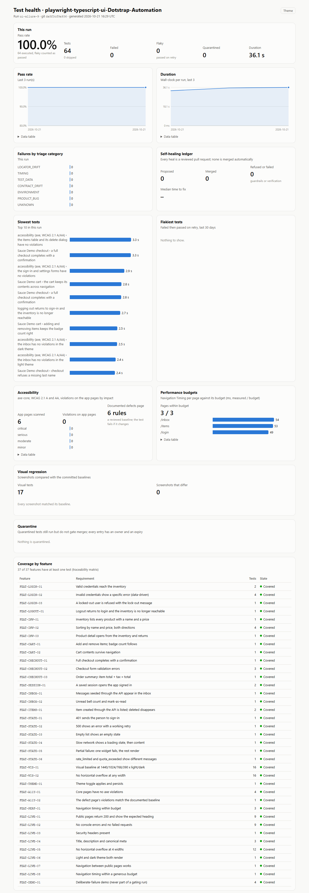
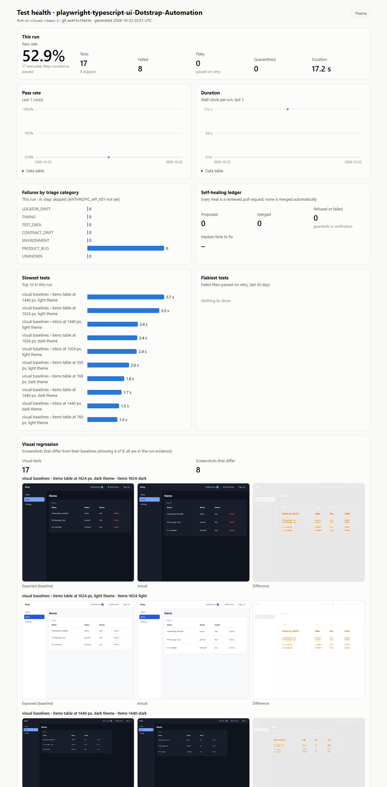
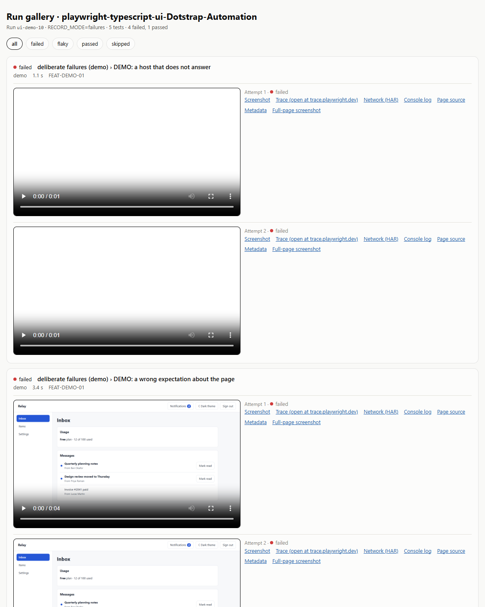
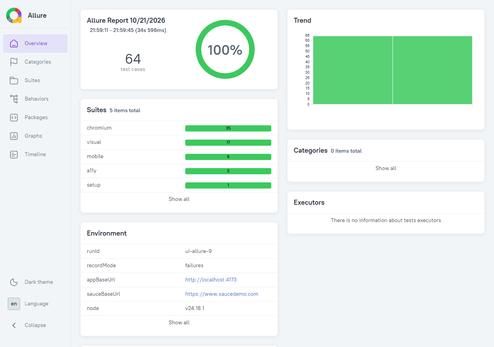

# Reporting

Each layer answers a different question. Screenshots below come from real local runs.

| Layer                                    | Answers                                                                      | Where it is written                       | Where CI puts it                              |
| ---------------------------------------- | ---------------------------------------------------------------------------- | ----------------------------------------- | --------------------------------------------- |
| List reporter and Playwright HTML report | Did it pass? What did this test do?                                          | Console, `playwright-report/`             | Job log, artifact (traces redacted)           |
| Step summary                             | What happened in this run, in one screen?                                    | `reports/site/summary.md`                 | Job summary and a sticky pull-request comment |
| Health dashboard                         | Are we healthy, and is it getting better or worse?                           | `reports/site/index.html`                 | GitHub Pages (nightly)                        |
| Run gallery                              | Each test, attempt by attempt, with video and links to every artifact        | `run-evidence/…/<run-id>/gallery.html`    | Pages, last 10 runs                           |
| Allure                                   | Steps, attachments, history, categories                                      | `allure-report/`                          | Pages, `allure/`                              |
| Failure bundle                           | Everything about one failed test, in one zip                                 | `run-evidence/…/failure-bundles/`         | Artifact                                      |
| Failure report                           | One page per failure: category, cause, failing locator, next action          | `failure-report.md` in each bundle        | Artifact                                      |
| Accessibility                            | Violations on the app pages by impact; the defects page against its baseline | Dashboard                                 | Pages                                         |
| Performance budgets                      | Time to first byte, DOMContentLoaded and load per page against the budget    | Dashboard                                 | Pages                                         |
| Visual differences                       | Expected, actual and difference images for every screenshot that changed     | Dashboard, `run-evidence/…/visual-diffs/` | Pages                                         |
| Traceability matrix                      | Which features have tests                                                    | `reports/traceability/`, dashboard        | Pages                                         |

## What CI keeps, and for how long

| Run                     | `RECORD_MODE` | Kept                                                                                                                                                 |
| ----------------------- | ------------- | ---------------------------------------------------------------------------------------------------------------------------------------------------- |
| Pull request (`ci.yml`) | `failures`    | Evidence and reports 14 days; failure bundles 30 days; summary as a PR comment                                                                       |
| Nightly (`nightly.yml`) | `all`         | Evidence for every test (video, trace, screenshots) 14 days; failure bundles 30 days; dashboard, gallery and Allure on Pages with 30 runs of history |
| Live smoke (nightly)    | `failures`    | A 7-day artifact; never published, never committed                                                                                                   |

Pages gets each run without its videos, traces, HAR files and bundles (one local run of the smoke
tests: 5.8 MB down to 0.95 MB), so the published gallery shows every test's screenshot; the full
evidence is in the workflow artifacts.

## Making them locally

```bash
npm test
npm run qa -- triage --run run-evidence/ui-automation-framework/<run-id>
npm run qa -- report --run run-evidence/ui-automation-framework/<run-id> --out reports/site
scripts/allure-report.sh [previous-report-dir]      # pass the last report to carry its trend
```

`report` appends the run to `reports/site/data/history.json` (30 runs kept) and also writes the step
summary to `$GITHUB_STEP_SUMMARY` when it runs in Actions.

## Health dashboard

One static file, no server, its template byte-identical with the API flagship's. Light and dark
follow the system and can be switched; every chart has a data table; it works at phone width.



UI sections appear only when their suite ran: accessibility by impact (the deliberately broken page
counted apart), performance budgets, and visual regression. This is the visual section of a real
run in which an unintended style change failed 8 baselines:



More: [dark](examples/dashboard/dashboard-dark.png), [390 px](examples/dashboard/dashboard-390px.png),
[one diff set](examples/visual-regression/).

## Run gallery

Failures first; each attempt with its video (the failure screenshot as poster) and links to the trace,
HAR, console log, page source and metadata.



## Allure

Allure 2 with the run's environment (run ID, record mode, targets, Node, OS), categories that mirror
the triage rules, trends carried from the previously published report, features from the feature
IDs, and a severity per test: smoke is a blocker, accessibility critical, the live smoke minor, the
demo trivial, everything else normal.



## Failure evidence

With `RECORD_MODE=failures`, a failed attempt keeps:

| File                             | What it is                                                      | How to open it                                              |
| -------------------------------- | --------------------------------------------------------------- | ----------------------------------------------------------- |
| `video.webm`                     | The browser session                                             | Any browser                                                 |
| `trace.zip`                      | Actions, DOM snapshots, network and console per step (redacted) | `npx playwright show-trace` or https://trace.playwright.dev |
| `screenshot.png`, `fullpage.png` | The viewport and the whole page at failure                      | An image viewer                                             |
| `network.har`                    | Requests and responses, headers only, secrets masked            | DevTools → Network → Import HAR                             |
| `console.log`                    | Console messages and failed requests (redacted)                 | A text editor                                               |
| `page-source.html`               | The DOM at failure (redacted); triage and the healer read it    | A browser                                                   |
| `meta.json`                      | Test identity, features, viewport, environment, git SHA         | A JSON viewer                                               |

A sample from a real run is in [examples/failure-evidence](examples/failure-evidence/).

Secrets are masked before anything is written: credential and cookie headers, cookies, token and
password fields, token query parameters, and header lines inside logs. Traces are redacted wherever
they are copied, including the copies Allure and the HTML report make.
