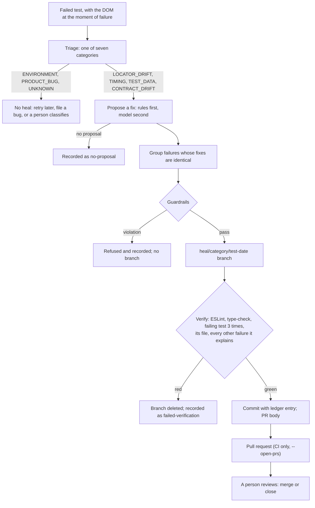

# Self-healing

A failed test can be healed only if its failure is in a healable category, a fix can be proposed,
the fix passes every guardrail, and the fix is proven on its own branch. Then a person reviews the
pull request. Nothing here merges anything, and nothing is substituted at run time: a heal is a
code change in a page object or component.

A real run of the whole pipeline, with every artifact it produced, is in
[examples/self-healing-demo](examples/self-healing-demo/).



## Categories

| Category         | Healable                   | What a fix may look like                                                                                         |
| ---------------- | -------------------------- | ---------------------------------------------------------------------------------------------------------------- |
| `LOCATOR_DRIFT`  | Yes                        | Rename a test id in the page objects and components that use it (rule-based); other locator changes (model only) |
| `TIMING`         | Yes                        | Wait for a state with a web-first assertion; never a fixed wait, never a timeout above 15 s (model only)         |
| `TEST_DATA`      | Yes                        | Fix the data fixture: unique names, verified cleanup (model only)                                                |
| `CONTRACT_DRIFT` | Yes, with a human decision | Follow an agreed API change in the client (model only)                                                           |
| `ENVIRONMENT`    | No                         | The site or network did not answer                                                                               |
| `PRODUCT_BUG`    | No                         | A content assertion, a screenshot difference or a console error                                                  |
| `UNKNOWN`        | No                         | A person reads the bundle and classifies it                                                                      |

## Proposing a fix

1. **Rule-based healer** (`rule-healer.ts`), for a test id that disappeared. It reads the DOM
   captured at the moment of failure (`page-source.html`) and picks the closest `data-test` value
   that shares a word with the old one (similarity 0.35 or more) and that no other locator already
   uses. It renames the id wherever a page object or component uses it. A changed role or name is
   never "healed": a user would notice it, so a person decides.
2. **AI healer** (`ai-healer.ts`), only when `ANTHROPIC_API_KEY` is set and the rules had nothing:
   `claude-opus-5-5` through the official SDK, structured JSON output, effort `medium`, server-side
   fallback on a safety decline. It sees the triage record, the page source and the files under the
   allowed folders; what it proposes goes through the same guardrails. A refusal or a truncated answer
   is a "no proposal". This step has not run in this project yet (see [known issues](known-issues.md)).

## Guardrails (enforced in code, `guardrails.ts`)

**Allowed paths**: `src/pages/`, `src/components/`, `src/fixtures/`, `src/data/`, `src/clients/`.

**Forbidden paths**: `tests/`, `playwright.config.ts`, `package.json`, `package-lock.json`,
`tsconfig.json`, `eslint.config.mjs`, `.github/`, `sut-ui/`, `tools/`, `docs/adr/`, `src/evidence/`,
`src/config/`.

**Forbidden in added lines**: `waitForTimeout` or `setTimeout` (fixed waits), `.skip`, `.fixme`,
`.fail` (disabled tests), `force: true`, `eslint-disable` and `@ts-ignore` style suppressions,
empty `catch` blocks and swallowing `.catch(() => {})`, positional or wildcard locators (`.first()`,
`.last()`, `.nth()`, `exact: false`, `/.*/` names), any change to `allowedConsoleErrors`, and any
timeout above 15 s.

**Forbidden in removed lines**: any check (`expect(`, `.toHave…`, `.toBe…`, `.toEqual`, `.toContain`).

Every rule has a unit test that proves it refuses (`tools/test/guardrails.test.ts`).

## Verification (`verify.ts`)

On the heal branch, in order, stopping at the first red step: ESLint, the type-check, the failing
test 3 times in a row (`--repeat-each=3`, retries off, one worker), its whole file, then once each
the other failures the same fix claims to explain.

## Budgets and records

- At most 3 pull requests per run, at most 2 attempts per failure per day.
- Failures with identical fixes share one branch; the pull request lists them.
- `healing-log.json` records every outcome with the guardrail results, the verification and the time
  to fix; the dashboard shows the ledger.
- If anything goes wrong in the middle of a heal, the heal branch is reset, the start branch restored
  and the heal branch deleted. A heal only starts from a clean working tree.
- Heal commits follow the repository's commit rules (header at most 100 characters, wrapped body).

## Running it

```bash
npm run qa -- triage --run run-evidence/ui-automation-framework/<run-id>
npm run qa -- heal --run run-evidence/ui-automation-framework/<run-id>
# in CI, heal.yml adds --open-prs after a failed nightly
```

To reproduce the demo: start the app with `SUT_UI_CHAOS=rename-testid` (`npm run sut`), run
`npx playwright test --project=chromium --project=mobile --project=a11y`, then the two commands above.
